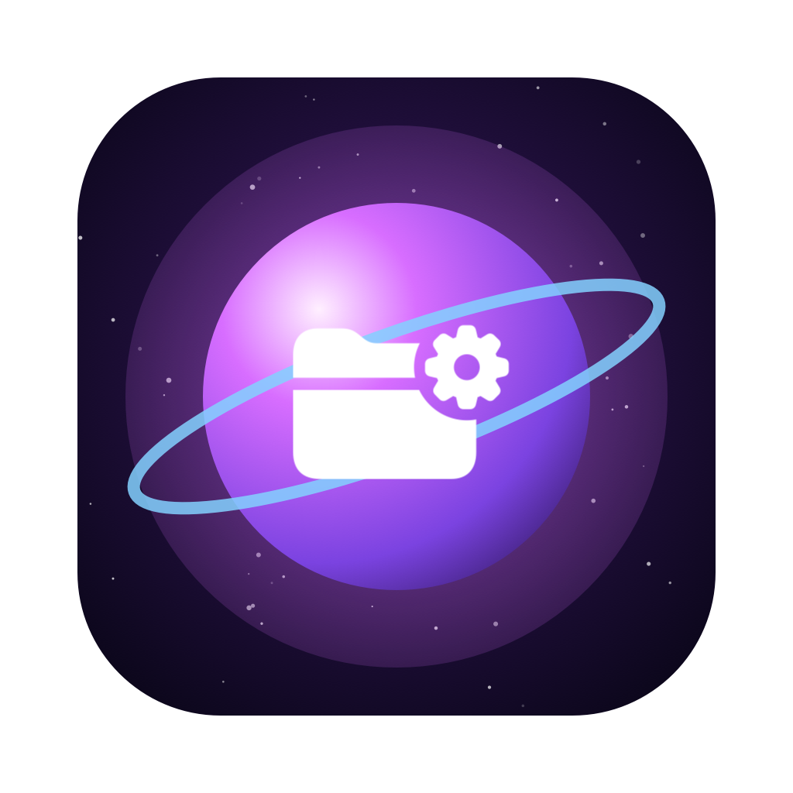
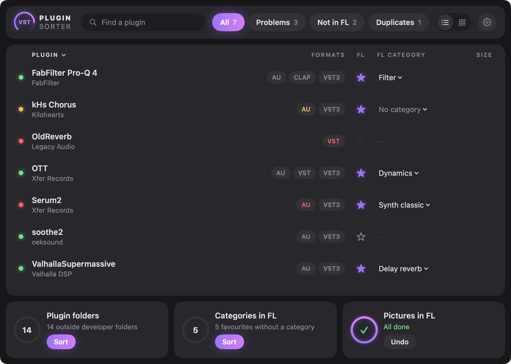
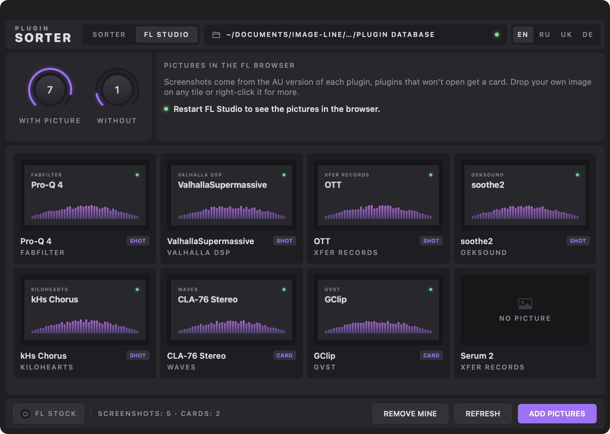
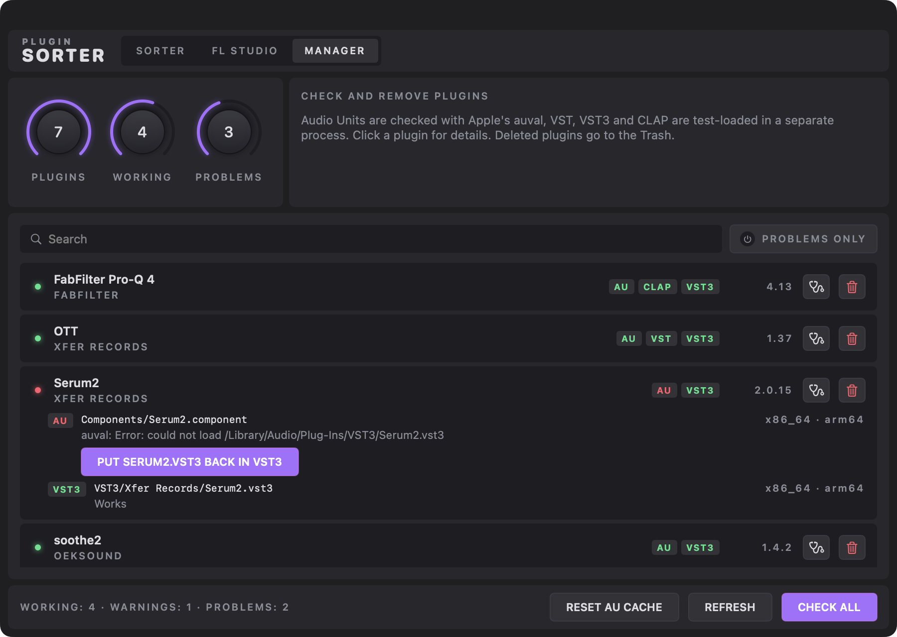

<p align="center">
  
</p>

<h1 align="center">Plugin Sorter</h1>

<p align="center">
  <b>Sort your VST3 and VST plugins into developer folders — in one click.</b>
</p>

<p align="center">
  <a href="https://github.com/Wirtexxx/plugin-sorter/actions/workflows/build.yml"></a>
  
  
  
  <a href="LICENSE"></a>
</p>

<p align="center">
  English · <a href="README.ru.md">Русский</a>
</p>

<p align="center">
  
</p>

---

## Why

After a few years of production `/Library/Audio/Plug-Ins/VST3` turns into a flat wall of
hundreds of bundles. Plugin Sorter reads who actually made each plugin and tidies everything up:

```
VST3/                                VST3/
├── FabFilter Pro-Q 4.vst3           ├── FabFilter/
├── OTT.vst3                         │   └── FabFilter Pro-Q 4.vst3
├── Serum2.vst3              ──►     ├── Xfer Records/
├── soothe2.vst3                     │   ├── OTT.vst3
└── ValhallaSupermassive.vst3        │   └── Serum2.vst3
                                     ├── oeksound/
                                     │   └── soothe2.vst3
                                     └── Valhalla DSP/
                                         └── ValhallaSupermassive.vst3
```

## Features

- 🔭 **Knows the real developer.** The vendor comes from the bundle identifier, not the file
  name, so `OTT` lands in *Xfer Records* and `soothe2` in *oeksound*.
- 👀 **Preview first.** You see every move grouped by developer before anything happens.
- ↩️ **One-click undo.** Every run writes a move log, and *Undo* puts everything back.
- 📁 **Respects your folders.** Existing vendor folders are reused, whatever their letter case.
- 🌊 **Leaves Waves alone.** WaveShells are managed by Waves Central and are skipped.
- 🖼️ **Plugin pictures in FL Studio.** Screenshots of every plugin's interface for FL's
  browser and plugin picker, the way FL's own plugins look there.
- 🗂️ **FL Studio categories in one click.** Favourites go under the picker's tabs (Dynamics,
  Filter, Delay reverb…) by the category each plugin reports about itself.
- 🩺 **Plugin manager.** Checks that every plugin actually loads (Apple's `auval` for AU,
  a test load for VST, VST3 and CLAP) and moves the ones you don't need to the Trash.
- 🧩 **Keeps Audio Units working.** AU stay in `Components`, and AU moved by 1.0 can be
  restored with one click.
- 🎛️ **Plugin-style UI.** Graphite panels, format knobs and a waveform of your developers,
  in English, Русский, Українська and Deutsch.
- ⌨️ **CLI included** for people who live in the terminal.

## Install

### Download

1. Download **[PluginSorter.dmg](https://github.com/Wirtexxx/plugin-sorter/releases/latest/download/PluginSorter.dmg)**
   from the latest release.
2. Open it and drag **Plugin Sorter** onto the **Applications** folder.
3. The app is not notarized, so on first launch right-click it → **Open**, or run:

   ```bash
   xattr -dr com.apple.quarantine "/Applications/Plugin Sorter.app"
   ```

### Build from source

Needs only the Xcode Command Line Tools (`xcode-select --install`):

```bash
git clone https://github.com/Wirtexxx/plugin-sorter.git
cd plugin-sorter
./build.sh --install
```

## Usage

### App

1. Open **Plugin Sorter**. It scans your plugin folders right away.
2. Toggle **VST3 / VST** to pick which folders to process.
3. Review the list and press **Sort**. macOS asks for an administrator password
   because `/Library/Audio/Plug-Ins` belongs to the system.
4. Changed your mind? Press **Undo**.

### Pictures in FL Studio

FL Studio shows a picture next to its own plugins in the browser, but third-party ones get
only a name. The **FL Studio** tab fixes that:

<p align="center">
  
</p>

1. Open the **FL Studio** tab. It lists the favourites from FL's plugin database
   (`~/Documents/Image-Line/FL Studio/Presets/Plugin database`).
2. Press **Add pictures**. For every plugin without a picture the app opens its Audio Unit
   editor for a moment, takes a screenshot and saves it next to the plugin's `.fst` preset,
   exactly where FL keeps its own pictures. Plugins that can't be opened get a card instead.
3. Restart FL Studio.

Drop any image on a tile to use your own, or right-click it to retake the screenshot, switch to
a card or remove the picture. **Remove mine** deletes everything Plugin Sorter added and
restores FL's `.nfo` files byte for byte.

> Plugin windows briefly pop up in the corner of the screen while screenshots are taken.
> Each plugin runs in its own helper process, so a plugin that crashes or hangs is simply skipped.

### Favourites in FL Studio

The **FL Studio** tab's **Favourites** section lists every plugin FL has scanned. Star the ones you
want in FL's browser and plugin picker, or click a format chip to pick VST3, AU or CLAP. Favourites
of plugins you deleted are listed on top and go away with one click; moved plugins are told apart and
left alone. Removed favourites are kept and **Put back removed** restores them.

**Sort by category** files every third-party favourite into FL's category folders, so the tabs at the
bottom of the plugin picker work for them too. The category comes from the plugin itself (VST3
sub-categories, CLAP features, read in a helper process), then from its name, and falls back to
*Effect*. Favourites you already put in a folder are left alone; right-click a plugin to choose its
category yourself. Pictures move along, and **Undo categories** puts everything back where it was.

### Manager: check and remove plugins

<p align="center">
  
</p>

The **Manager** tab lists every plugin in `/Library/Audio/Plug-Ins` with all its formats.
**Check all** verifies that each one can really be loaded:

| Format | How it's checked |
| ------ | ---------------- |
| AU | Apple's `auval -v`, the same validation Logic runs |
| VST3 | loaded in a helper process, `bundleEntry` + `GetPluginFactory` |
| VST | loaded in a helper process, `VSTPluginMain` must exist |
| CLAP | loaded in a helper process, `clap_entry` must exist |

It also flags binaries built for another CPU, Intel-only plugins on Apple Silicon, quarantined
downloads and Audio Units that macOS can't see. Click a plugin to see the exact reason, and
use the trash button to move all its formats to the Trash after confirming the file list.

Many problems come with a one-click fix right under them: **Remove quarantine**, **Move back to
Components** for an Audio Unit in a subfolder, **Reset AU cache**, and **Put … back** when a plugin
loads another bundle from a fixed path that was moved (Serum 2's AU loads `VST3/Serum2.vst3`).
Bundles put back this way are remembered, so sorting never moves them again.

**By size** sorts plugins by the space they take, and a plugin's details list its developer's data
folders (presets, libraries in Application Support and Audio/Presets) with their size. Those are only
shown, never deleted.

### Command line

```bash
./scripts/sort-plugins.sh                      # dry run: show what would move
sudo ./scripts/sort-plugins.sh --apply         # move plugins, write ~/plugin-sort-<time>.log
sudo ./scripts/sort-plugins.sh --undo ~/plugin-sort-20261102-193000.log
sudo ./scripts/sort-plugins.sh --restore-au    # put AU sorted by 1.0 back into Components
```

| Variable              | Default                 | Purpose                         |
| --------------------- | ----------------------- | ------------------------------- |
| `PLUGIN_SORT_FORMATS` | `VST3 VST`              | Folders to process              |
| `PLUGIN_SORT_LOG_DIR` | invoking user's home    | Where the move log is written   |
| `PLUGIN_SORT_OWNER`   | `$SUDO_USER`            | Owner of the move log           |

## How it works

Each plugin bundle has a reverse-DNS identifier in `Contents/Info.plist`. Plugin Sorter skips
the domain parts and takes the first meaningful word as the developer:

| Bundle identifier                  | Folder         |
| ---------------------------------- | -------------- |
| `com.fabfilter.Pro-Q.4`            | `FabFilter`    |
| `com.xfer.OTT`                     | `Xfer Records` |
| `co.uk.gvst.GClip`                 | `GVST`         |
| `app.cradle.GodParticle`           | `Cradle`       |

Pretty names for well-known developers live in `pretty_name()` in
[`scripts/sort-plugins.sh`](scripts/sort-plugins.sh). Anything else keeps the name from its
identifier. Missing your favourite developer? Pull requests are welcome.

## Good to know

- DAWs scan VST and VST3 folders recursively, and hosts identify plugins by their IDs rather
  than file paths, so existing projects keep loading them.
- **Audio Units are not sorted.** macOS only registers components that sit directly in
  `/Library/Audio/Plug-Ins/Components`, so an AU in a subfolder disappears from every host.
  Version 1.0 did sort them: if your AU vanished, open the app and press **Restore AU**
  (or run `--restore-au`), then restart your DAW.
- Plugin installers usually drop updates back into the root folder. Just run Plugin Sorter again.

## Project structure

```
App/            SwiftUI app: model, window, theme, translations
scripts/        sort-plugins.sh: the engine, usable on its own
Tests/          Swift Testing suite for the parsers, checks and the script
tools/          icon and README screenshot renderers
build.sh        builds a universal Plugin Sorter.app without Xcode
Package.swift   test-only package around the UI-free part of App/
```

## Development

Everything works with just the Command Line Tools:

```bash
swift test                  # parsers, inventory, checks and sort-plugins.sh on temporary folders
./build.sh --install        # build and install the app
./build.sh --screenshot     # re-render the README screenshots
```

Tests never touch `/Library/Audio/Plug-Ins` or FL Studio's database: the script runs against a
temporary tree via `PLUGIN_SORT_ROOT`, and plugin bundles and `.fst` presets are generated on the fly.

## License

[MIT](LICENSE) © Wirtex
