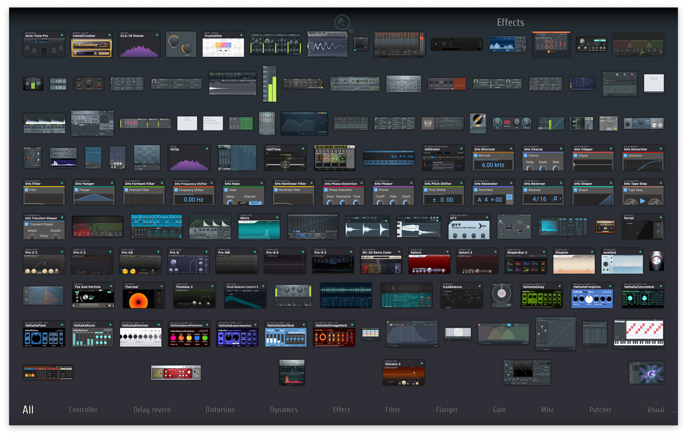

<p align="center">
  
</p>

<h1 align="center">Plugin Sorter</h1>

<p align="center">
  <b>A free plugin manager for macOS: sort VST3 and VST plugins into developer folders, test every plugin, remove duplicates, and bring plugin pictures to FL Studio.</b>
</p>

<p align="center">
  <a href="https://github.com/Wirtexxx/plugin-sorter/actions/workflows/build.yml"></a>
  
  
  
  <a href="LICENSE"></a>
</p>

<p align="center">
  English · <a href="README.ru.md">Русский</a>
</p>

<p align="center">
  
</p>

---

## Why

After a few years of production `/Library/Audio/Plug-Ins/VST3` turns into a flat wall of
hundreds of bundles. Plugin Sorter reads who actually made each plugin and tidies everything up:

```
VST3/                                VST3/
├── FabFilter Pro-Q 4.vst3           ├── FabFilter/
├── OTT.vst3                         │   └── FabFilter Pro-Q 4.vst3
├── Serum2.vst3              ──►     ├── Xfer Records/
├── soothe2.vst3                     │   ├── OTT.vst3
└── ValhallaSupermassive.vst3        │   └── Serum2.vst3
                                     ├── oeksound/
                                     │   └── soothe2.vst3
                                     └── Valhalla DSP/
                                         └── ValhallaSupermassive.vst3
```

## Features

- 🔭 **Knows the real developer.** The vendor comes from the bundle identifier, not the file
  name, so `OTT` lands in *Xfer Records* and `soothe2` in *oeksound*.
- 👀 **Preview first.** You see every move grouped by developer before anything happens.
- ↩️ **One-click undo.** Every run writes a move log, and *Undo* puts everything back.
- 📁 **Respects your folders.** Existing vendor folders are reused, whatever their letter case.
- 🌊 **Leaves Waves alone.** WaveShells are managed by Waves Central and are skipped.
- 🖼️ **Plugin pictures in FL Studio.** Screenshots of plugin interfaces for FL's
  browser and plugin picker, the way FL's own plugins look there.
- 🗂️ **FL Studio categories in one click.** Favourites go under the picker's tabs (Dynamics,
  Filter, Delay reverb…) by the category each plugin reports about itself.
- 🩺 **Plugin manager.** Checks that every plugin actually loads (Apple's `auval` for AU,
  a test load for VST, VST3 and CLAP), including the ones in `~/Library/Audio/Plug-Ins`.
- 🧹 **Clean uninstall.** Turn a plugin off without deleting it, or remove it with its preferences,
  caches and installer receipts. Old versions and duplicates are found for you.
- 🏷️ **Your own catalogue.** Tags and colours, licenses kept in the Keychain, and the list exported
  to Markdown, CSV or JSON.
- 🧩 **Keeps Audio Units working.** AU stay in `Components`, and AU moved by 1.0 can be
  restored with one click.
- 🎛️ **Plugin-style UI.** Graphite panels, status lamps and colour skins, in English, Русский,
  Українська and Deutsch.
- ⌨️ **CLI included** for people who live in the terminal.

## In FL Studio

Third-party plugins finally look like FL's own: a real picture of each one, filed under the tabs
of the plugin picker.

<p align="center">
  
</p>

## Install

### Download

1. Download **[PluginSorter.dmg](https://github.com/Wirtexxx/plugin-sorter/releases/latest/download/PluginSorter.dmg)**
   from the latest release.
2. Open it and drag **Plugin Sorter** onto the **Applications** folder.
3. The app is not notarized, so macOS refuses the first launch. On macOS 15 and later open
   **System Settings → Privacy & Security** and click **Open Anyway** (on older versions: right-click the app → **Open**), or run:

   ```bash
   xattr -dr com.apple.quarantine "/Applications/Plugin Sorter.app"
   ```

### Build from source

Needs only the Xcode Command Line Tools (`xcode-select --install`):

```bash
git clone https://github.com/Wirtexxx/plugin-sorter.git
cd plugin-sorter/app
./build.sh --install
```

## Usage

### One window

<p align="center">
  
</p>

Open **Plugin Sorter** and every plugin in `/Library/Audio/Plug-Ins` and `~/Library/Audio/Plug-Ins`
is right there, one row per plugin with all its formats. Each row shows whether it works, whether it's in FL Studio's favourites
(the star), its FL category and its size.

- **Search and filters** at the top: **All** and **Not in FL**, plus **Problems**, **New**,
  **Duplicates**, **Off** and **Tags** once they have something to show. **⌘F** jumps to the search.
- **Checks run by themselves** in the background and are remembered, so the lights are on as soon as
  the window opens; only new and updated plugins are checked again.

| Format | How it's checked |
| ------ | ---------------- |
| AU | Apple's `auval -v`, the same validation Logic runs |
| VST3 | loaded in a helper process, `bundleEntry` + `GetPluginFactory` |
| VST | loaded in a helper process, `VSTPluginMain` must exist |
| CLAP | loaded in a helper process, `clap_entry` must exist |

- **Click a plugin** to open it in place: what's wrong in plain words with a one-click **Fix**
  (remove quarantine, move an AU back to Components, reset the AU cache, put a moved bundle back
  where another plugin loads it) and a ready draft for the developer's support. Tabs hold its files,
  its picture in FL, your tags and its license. **Show in Finder**, **Turn off** and **Check again** are
  always at hand; **Uninstall…** and **Move to Trash** are in the **…** menu.
- **Turn off** moves a plugin out of every host's sight without deleting it, and it can be turned on
  again at any time. **Uninstall…** also offers what the plugin left behind. Its developer's folder is
  never ticked for you, as it may hold libraries you paid for.
- **Duplicates** lists old versions and extra copies. Nothing is ticked at first, and everything goes
  to the Trash.
- **The star** adds the plugin to FL's browser and plugin picker or removes it; inside the row, each
  format can be picked on its own. **The category** next to it is a menu of FL's category folders.
- **Click a column title** to sort by name or by size.
- **Switch to cards** with the button at the top right, next to the gear. Each plugin becomes a small
  tile with its picture from FL; plugins without one get a generated card, shown only here. A click on
  a tile opens its details in a panel on the right, as in Finder's preview pane. Close it with the cross,
  Esc or another click on the tile. The app remembers which view you chose.

<p align="center">
  
</p>

Three jobs sit at the bottom, each showing what's left:

- **Plugin folders** — shows what moves into which developer folder, then sorts it. macOS asks for an
  administrator password because `/Library/Audio/Plug-Ins` belongs to the system.
- **Categories in FL** — files every third-party favourite into FL's category folders, so the tabs at
  the bottom of FL's plugin picker work for them too. The category comes from the plugin itself (VST3
  sub-categories, CLAP features), then from its name, and falls back to *Effect*.
- **Pictures in FL** — FL shows a picture next to its own plugins but not next to third-party ones.
  This opens each plugin's Audio Unit editor for a moment, takes a screenshot and saves it where FL
  keeps its own pictures; plugins that can't be opened get a card. Drop any image on a plugin's
  picture to use your own.

Once all three are done they fold into a small strip; click it to open them again. Every job can be
undone. If FL Studio is open while the app changes its plugin database, it asks first:
FL shows the changes after a restart. It also asks before moving plugin files while a DAW is open.
The gear menu has a full recheck, **Reset AU cache**, screenshots of all plugins, putting back
favourites removed from FL, exporting the list, and the settings (language, colour skin).

> Plugin windows briefly pop up in the corner of the screen while screenshots are taken.
> Each plugin runs in its own helper process, so a plugin that crashes or hangs is simply skipped.
> Plugins in quarantine are not loaded until you clear the flag.

### Command line

```bash
./app/scripts/sort-plugins.sh                      # dry run: show what would move
sudo ./app/scripts/sort-plugins.sh --apply         # move plugins, write ~/plugin-sort-<time>.log
sudo ./app/scripts/sort-plugins.sh --undo ~/plugin-sort-20261102-193000.log
sudo ./app/scripts/sort-plugins.sh --restore-au    # put AU sorted by 1.0 back into Components
```

| Variable              | Default                 | Purpose                         |
| --------------------- | ----------------------- | ------------------------------- |
| `PLUGIN_SORT_FORMATS` | `VST3 VST`              | Folders to process              |
| `PLUGIN_SORT_LOG_DIR` | invoking user's home    | Where the move log is written   |
| `PLUGIN_SORT_OWNER`   | `$SUDO_USER`            | Owner of the move log           |

## How it works

Each plugin bundle has a reverse-DNS identifier in `Contents/Info.plist`. Plugin Sorter skips
the domain parts and takes the first meaningful word as the developer:

| Bundle identifier                  | Folder         |
| ---------------------------------- | -------------- |
| `com.fabfilter.Pro-Q.4`            | `FabFilter`    |
| `com.xfer.OTT`                     | `Xfer Records` |
| `co.uk.gvst.GClip`                 | `GVST`         |
| `app.cradle.GodParticle`           | `Cradle`       |

Pretty names for well-known developers live in `pretty_name()` in
[`app/scripts/sort-plugins.sh`](app/scripts/sort-plugins.sh). Anything else keeps the name from its
identifier. Missing your favourite developer? Pull requests are welcome.

## Good to know

- DAWs scan VST and VST3 folders recursively, and hosts identify plugins by their IDs rather
  than file paths, so existing projects keep loading them.
- **Audio Units are not sorted.** macOS only registers components that sit directly in
  `/Library/Audio/Plug-Ins/Components`, so an AU in a subfolder disappears from every host.
  Version 1.0 did sort them: if your AU vanished, click the plugin and press **Move back to Components**
  (or run `--restore-au` for all of them), then restart your DAW.
- Plugin installers usually drop updates back into the root folder. Just run Plugin Sorter again.

## Project structure

```
app/                macOS app
  Sources/          SwiftUI app: model, window, theme, translations
  Helper/           entry point of the helper that loads plugins, apart from the app
  scripts/          sort-plugins.sh: the engine, usable on its own
  Tests/            Swift Testing suite for the parsers, checks and the script
  tools/            icon and README screenshot renderers
  build.sh          builds a universal Plugin Sorter.app without Xcode
  Package.swift     test-only package around Sources/, without the @main entry point
web/                landing page: static English and Russian pages
docs/               screenshots and the icon, used by the README and the site
```

## Development

The app needs only the Command Line Tools:

```bash
cd app
swift test                  # parsers, inventory, checks and sort-plugins.sh on temporary folders
./build.sh --install        # build and install the app
./build.sh --screenshot     # re-render the README screenshots
```

The site needs Node 22:

```bash
cd web
npm ci
npm run preview             # build and serve on http://localhost:4173
npm test                    # pages and search markup
npm run test:browser        # layout and the download path in real browsers
npm run audit               # Lighthouse
```

Publishing steps are in [`web/LAUNCH.md`](web/LAUNCH.md).

Tests never touch `/Library/Audio/Plug-Ins` or FL Studio's database: the script runs against a
temporary tree via `PLUGIN_SORT_ROOT`, and plugin bundles and `.fst` presets are generated on the fly.

## License

[MIT](LICENSE) © Wirtex
