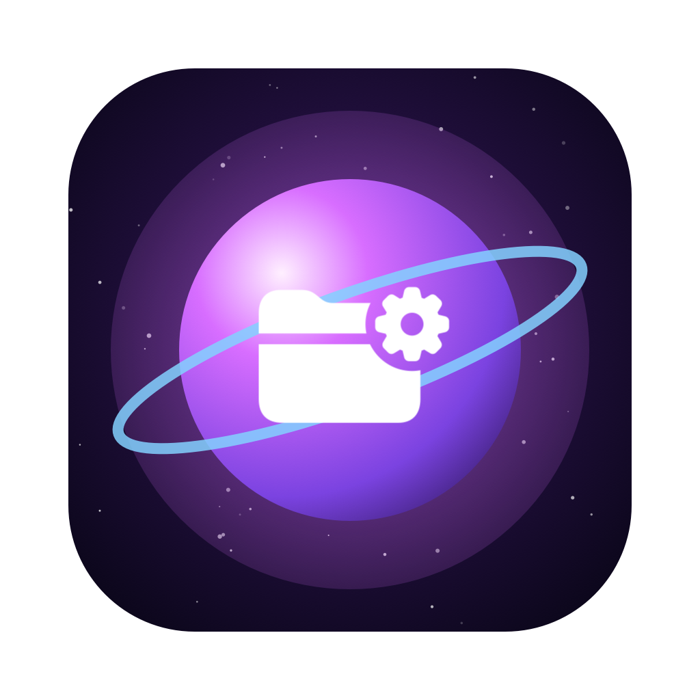
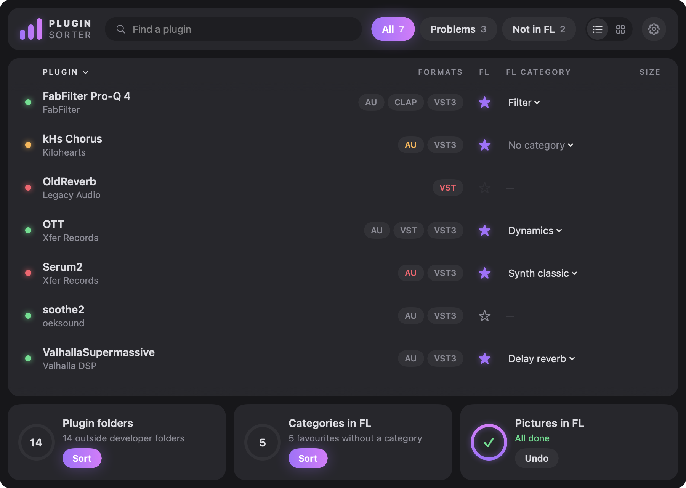
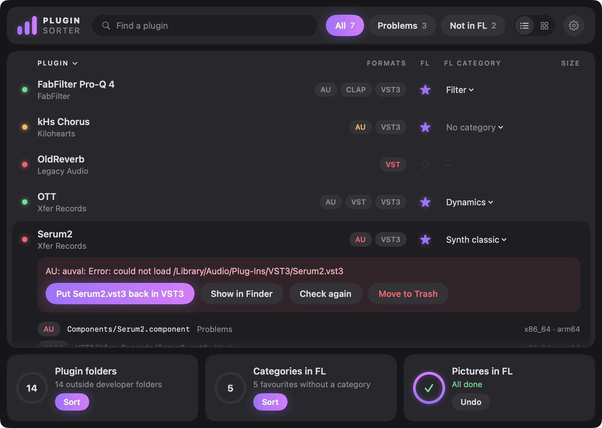
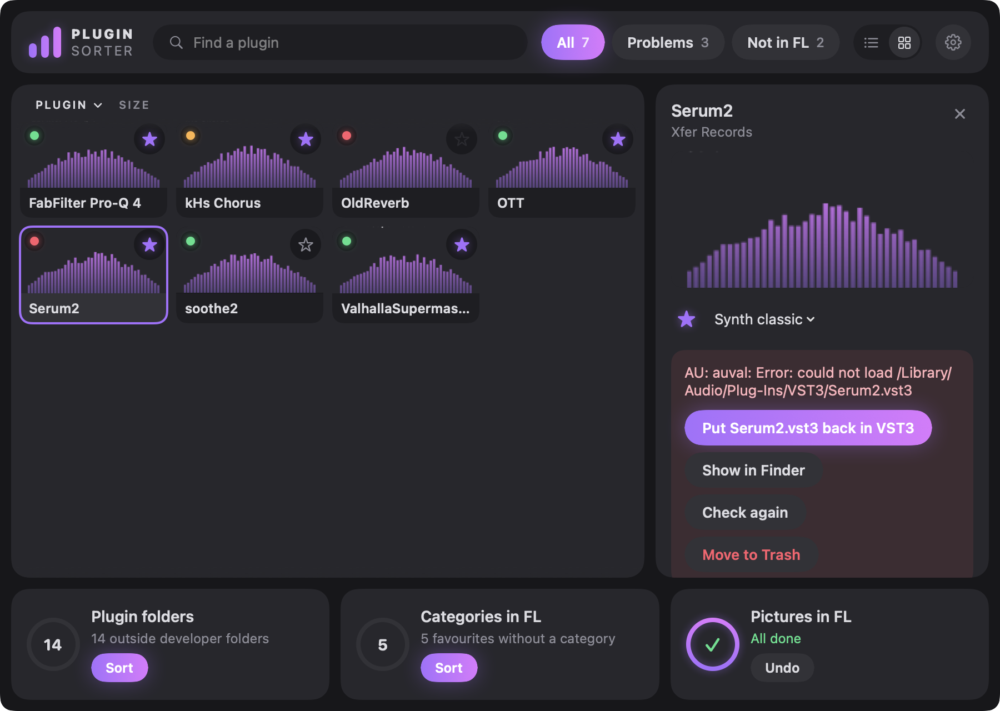

<p align="center">
  
</p>

<h1 align="center">Plugin Sorter</h1>

<p align="center">
  <b>Раскладывает VST3 и VST плагины по папкам разработчиков — в один клик.</b>
</p>

<p align="center">
  <a href="https://github.com/Wirtexxx/plugin-sorter/actions/workflows/build.yml"></a>
  
  
  
  <a href="LICENSE"></a>
</p>

<p align="center">
  <a href="README.md">English</a> · Русский
</p>

<p align="center">
  
</p>

---

## Зачем

За пару лет продакшена `/Library/Audio/Plug-Ins/VST3` превращается в сплошную стену
из сотен бандлов. Plugin Sorter определяет, кто на самом деле сделал каждый плагин, и наводит порядок:

```
VST3/                                VST3/
├── FabFilter Pro-Q 4.vst3           ├── FabFilter/
├── OTT.vst3                         │   └── FabFilter Pro-Q 4.vst3
├── Serum2.vst3              ──►     ├── Xfer Records/
├── soothe2.vst3                     │   ├── OTT.vst3
└── ValhallaSupermassive.vst3        │   └── Serum2.vst3
                                     ├── oeksound/
                                     │   └── soothe2.vst3
                                     └── Valhalla DSP/
                                         └── ValhallaSupermassive.vst3
```

## Возможности

- 🔭 **Знает настоящего разработчика.** Он берётся из идентификатора бандла, а не из имени
  файла, поэтому `OTT` попадает в *Xfer Records*, а `soothe2` в *oeksound*.
- 👀 **Сначала предпросмотр.** Все перемещения видны заранее, сгруппированные по разработчикам.
- ↩️ **Откат в один клик.** Каждый запуск пишет лог, и кнопка *Откатить* возвращает всё назад.
- 📁 **Уважает ваши папки.** Существующие папки разработчиков используются повторно, независимо от регистра.
- 🌊 **Не трогает Waves.** WaveShell управляется Waves Central и пропускается.
- 🖼️ **Картинки плагинов в FL Studio.** Скриншоты интерфейса каждого плагина для браузера
  и плагин-пикера FL — как у стоковых плагинов FL.
- 🗂️ **Категории FL Studio одним нажатием.** Избранное раскладывается по вкладкам пикера (Dynamics,
  Filter, Delay reverb…) по категории, которую сообщает сам плагин.
- 🩺 **Менеджер плагинов.** Проверяет, что каждый плагин действительно загружается
  (`auval` от Apple для AU, пробная загрузка для VST, VST3 и CLAP), и убирает ненужные в Корзину.
- 🧩 **Не ломает Audio Units.** AU остаются в `Components`, а AU, разложенные версией 1.0,
  возвращаются на место одной кнопкой.
- 🎛️ **Интерфейс в стиле плагинов.** Графитовые панели, ручки форматов и «волна» разработчиков,
  на English, Русском, Українській и Deutsch.
- ⌨️ **Есть CLI** для тех, кто живёт в терминале.

## Установка

### Скачать

1. Скачайте **[PluginSorter.dmg](https://github.com/Wirtexxx/plugin-sorter/releases/latest/download/PluginSorter.dmg)**
   из последнего релиза.
2. Откройте его и перетащите **Plugin Sorter** на папку **Applications**.
3. Приложение не нотаризовано, поэтому при первом запуске нажмите по нему правой кнопкой → **Открыть**
   или выполните:

   ```bash
   xattr -dr com.apple.quarantine "/Applications/Plugin Sorter.app"
   ```

### Собрать из исходников

Нужны только Command Line Tools (`xcode-select --install`):

```bash
git clone https://github.com/Wirtexxx/plugin-sorter.git
cd plugin-sorter
./build.sh --install
```

## Использование

### Одно окно

<p align="center">
  
</p>

Откройте **Plugin Sorter** — и все плагины из `/Library/Audio/Plug-Ins` сразу перед вами, по строке на
плагин со всеми его форматами. В строке видно, работает ли он, есть ли в избранном FL Studio (звезда),
его категория в FL и размер.

- **Поиск и фильтры** сверху: **Все**, **Проблемы**, **Не в FL**.
- **Проверка идёт сама** в фоне и запоминается: индикаторы горят сразу при открытии, заново
  проверяются только новые и обновлённые плагины.

| Формат | Как проверяется |
| ------ | --------------- |
| AU | `auval -v` от Apple — та же проверка, что в Logic |
| VST3 | загрузка во вспомогательном процессе, `bundleEntry` + `GetPluginFactory` |
| VST | загрузка во вспомогательном процессе, должен быть `VSTPluginMain` |
| CLAP | загрузка во вспомогательном процессе, должен быть `clap_entry` |

- **Клик по плагину** раскрывает его прямо в списке: что не так, человеческими словами, и кнопка
  **Починить** (снять карантин, вернуть AU в Components, сбросить кеш AU, вернуть файл туда, откуда
  его грузит другой плагин), **Показать в Finder**, **В Корзину**, форматы, картинка в FL и папки
  с данными разработчика (только показываются, не удаляются).
- **Звезда** добавляет плагин в браузер и плагин-пикер FL или убирает; в раскрытой строке можно
  выбрать отдельный формат. **Категория** рядом — меню папок категорий FL.
- **Клик по заголовку столбца** сортирует по имени или по размеру.
- **Переключиться на карточки** можно кнопкой вверху справа, рядом с шестерёнкой. Каждый плагин становится
  маленькой плиткой с картинкой из FL; плагины без картинки получают автоматическую карточку, видную только
  здесь. Клик по плитке открывает подробности в панели справа, как область просмотра в Finder. Закрыть её
  можно крестиком, клавишей Esc или повторным кликом по плитке. Выбранный вид запоминается.

<p align="center">
  
</p>

Внизу — три дела, у каждого видно, сколько осталось:

- **Папки плагинов** — показывает, что в какую папку разработчика переедет, и раскладывает. macOS
  спросит пароль администратора: `/Library/Audio/Plug-Ins` принадлежит системе.
- **Категории в FL** — раскладывает избранное сторонних плагинов по папкам категорий FL, и вкладки
  внизу плагин-пикера начинают работать и для них. Категорию сообщает сам плагин (подкатегории VST3,
  features CLAP), иначе она подбирается по имени, иначе ставится *Effect*.
- **Картинки в FL** — у стоковых плагинов в браузере FL есть картинка, у сторонних нет. Приложение на
  секунду открывает редактор AU-версии, делает скриншот и кладёт его туда же, где FL хранит свои;
  плагинам, которые не открылись, рисуется карточка. Перетащите любую картинку на картинку плагина,
  чтобы поставить свою.

Когда выполнены все три дела, они сворачиваются в маленькую полоску; нажатие снова их открывает. Любое
дело можно отменить. Если FL Studio открыт, приложение спросит, прежде чем менять его базу
плагинов: изменения появятся после перезапуска FL. В меню шестерёнки — проверить всё заново,
**Сбросить кеш AU**, вернуть убранное из избранного FL и настройки (язык, скин).

> Во время съёмки окна плагинов на мгновение появляются в углу экрана.
> Каждый плагин работает в отдельном процессе, поэтому упавший или зависший плагин просто пропускается.

### Командная строка

```bash
./scripts/sort-plugins.sh                      # пробный запуск: что будет перемещено
sudo ./scripts/sort-plugins.sh --apply         # переместить, лог в ~/plugin-sort-<время>.log
sudo ./scripts/sort-plugins.sh --undo ~/plugin-sort-20261102-193000.log
sudo ./scripts/sort-plugins.sh --restore-au    # вернуть AU, разложенные версией 1.0, в Components
```

| Переменная            | По умолчанию            | Назначение                      |
| --------------------- | ----------------------- | ------------------------------- |
| `PLUGIN_SORT_FORMATS` | `VST3 VST`              | Какие папки обрабатывать        |
| `PLUGIN_SORT_LOG_DIR` | домашняя папка          | Куда писать лог перемещений     |
| `PLUGIN_SORT_OWNER`   | `$SUDO_USER`            | Владелец файла лога             |

## Как это работает

У каждого бандла плагина в `Contents/Info.plist` есть идентификатор в формате обратного DNS.
Plugin Sorter пропускает доменные части и берёт первое осмысленное слово как имя разработчика:

| Идентификатор бандла               | Папка          |
| ---------------------------------- | -------------- |
| `com.fabfilter.Pro-Q.4`            | `FabFilter`    |
| `com.xfer.OTT`                     | `Xfer Records` |
| `co.uk.gvst.GClip`                 | `GVST`         |
| `app.cradle.GodParticle`           | `Cradle`       |

Красивые имена известных разработчиков задаются в `pretty_name()` в
[`scripts/sort-plugins.sh`](scripts/sort-plugins.sh). Остальные получают имя из идентификатора.
Нет вашего любимого разработчика? Присылайте pull request.

## Полезно знать

- DAW сканируют папки VST и VST3 рекурсивно и находят плагины по их ID, а не по пути к файлу,
  поэтому существующие проекты продолжают их загружать.
- **Audio Units не сортируются.** macOS регистрирует только компоненты, лежащие прямо в
  `/Library/Audio/Plug-Ins/Components`, поэтому AU в подпапке пропадает из всех хостов.
  Версия 1.0 их сортировала: если AU пропали, откройте приложение и нажмите **Вернуть AU**
  (или запустите `--restore-au`), затем перезапустите DAW.
- Установщики плагинов обычно кладут обновления обратно в корень папки. Просто запустите Plugin Sorter ещё раз.

## Структура проекта

```
App/            SwiftUI-приложение: модель, окно, тема, переводы
scripts/        sort-plugins.sh — движок, работает и сам по себе
Tests/          тесты на Swift Testing: парсеры, проверки и сам скрипт
tools/          генераторы иконки и скриншота для README
build.sh        собирает универсальный Plugin Sorter.app без Xcode
Package.swift   пакет только для тестов вокруг части App/ без интерфейса
```

## Разработка

Всё работает с одними Command Line Tools:

```bash
swift test                  # парсеры, опись, проверки и sort-plugins.sh на временных папках
./build.sh --install        # собрать и установить приложение
./build.sh --screenshot     # перерисовать скриншоты для README
```

Тесты не трогают `/Library/Audio/Plug-Ins` и базу FL Studio: скрипт работает на временном дереве
через `PLUGIN_SORT_ROOT`, а бандлы плагинов и `.fst`-пресеты генерируются на лету.

## Лицензия

[MIT](LICENSE) © Wirtex
